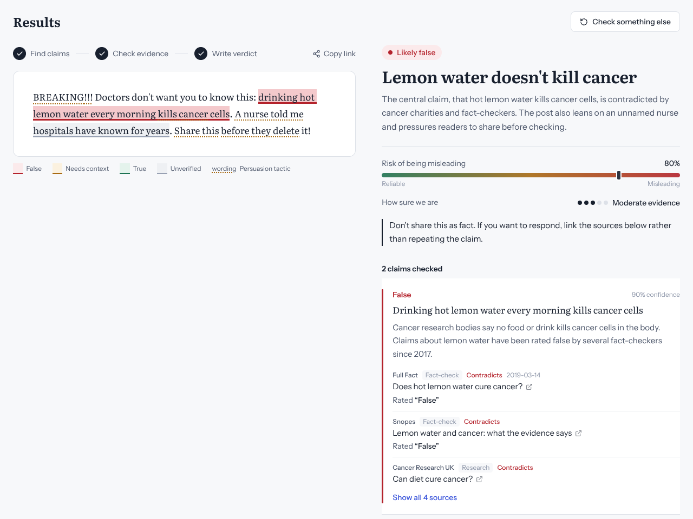
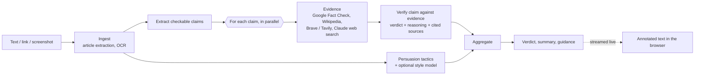

# MisInfo AI

Paste a post, a link or a screenshot. MisInfo AI pulls out each factual claim,
looks for evidence from fact-checkers and reliable sources, and shows you, right
on the text, which parts are true, false, or missing context, with every source linked.


<sub>UI preview with example data.</sub>

> Version 2 is a rebuild of my final-year dissertation project (supervised by
> **Galvin Kaiyamo**, University of East London). The original is on `main`;
> [docs/V1_AUDIT.md](docs/V1_AUDIT.md) explains what was wrong with it and why v2 works differently.

## How it works



**Evidence decides the verdict.** A claim is only marked false when reliable
evidence contradicts it. Writing style and persuasion tactics (urgency, conspiracy
framing, pressure to share…) are shown and highlighted, but they can only nudge
the risk score where evidence is missing, and confidence reflects how much of the
content is actually backed by evidence. With no AI model configured, the app falls
back to matching published fact-checks and says "unverified" rather than guessing.

Everything streams: you see claims appear, then turn red, amber or green one by one.

## Quick start (Docker)

```bash
cp backend/.env.example backend/.env    # add keys (all optional)
docker compose up --build
```

Open http://localhost:8080.

## Local development

```bash
# Backend (Python 3.11+)
cd backend
python -m venv .venv && source .venv/bin/activate
pip install -r requirements-dev.txt -r requirements-ml.txt
cp .env.example .env
uvicorn app.main:app --reload            # http://localhost:8000/api/docs

# Frontend (Node 20+), in another terminal
cd frontend
npm install
npm run dev                               # http://localhost:5173 (proxies /api to :8000)
```

Screenshot reading needs [Tesseract](https://tesseract-ocr.github.io/tessdoc/Installation.html)
(`brew install tesseract` / `apt install tesseract-ocr`). It's included in the Docker image.

## Configuration

All settings are environment variables (see [`backend/.env.example`](backend/.env.example)).

| Setting | What it does |
|---|---|
| `LLM_PROVIDER` | `anthropic` (best: cited reasoning + its own web search), `ollama` (free, local, no web search) or `none` |
| `ANTHROPIC_API_KEY`, `LLM_MODEL`, `LLM_FAST_MODEL` | Claude models for verification and for claim extraction/summaries |
| `GOOGLE_FACTCHECK_API_KEY` | Free key; searches published fact-checks worldwide. Strongly recommended |
| `BRAVE_API_KEY` / `TAVILY_API_KEY` | Optional general web search |
| `STORE_INPUT_TEXT` | `false` keeps verdicts in history but not the pasted text |
| `DATABASE_URL` | Defaults to SQLite; any SQLAlchemy URL (e.g. Postgres) works |

## API

Interactive docs at `/api/docs`.

| Method | Path | |
|---|---|---|
| `POST` | `/api/analyze/stream` | `{"text": "..."}` or `{"url": "..."}`; Server-Sent Events: `input`, `stage`, `claims`, `tactics`, `style`, `claim_result`, `result` |
| `POST` | `/api/analyze/image/stream` | multipart `file`; same events |
| `POST` | `/api/analyze` | same input, returns the final result as JSON |
| `GET` | `/api/history`, `/api/history/{id}` | past checks; `DELETE` removes one |
| `GET` | `/api/stats` | aggregates for the Insights page |
| `GET` | `/api/health` | which model and sources are active |

## Project layout

```
backend/
  app/
    pipeline/    ingest, claims → retrieval → verify, tactics, style, aggregate, orchestrator
    llm/         provider interface + Claude, Ollama and no-LLM implementations
    services/    HTTP client with caching, source credibility
    main.py      FastAPI routes, streaming, rate limiting
  tests/         21 tests, no network or keys needed
frontend/
  src/           React app: annotated text view, history, insights
training/        leak-free data prep, TF-IDF baseline, transformer fine-tuning → ONNX
docs/            v1 audit + MisInfo-AI-Guide.pdf (full beginner guide)
```

## Training the optional style model

See [training/README.md](training/README.md). The pipeline fixes v1's label and
leakage problems and reports leave-one-dataset-out results, the honest measure of
how well a model handles sources it hasn't seen.

## Limits

Automated fact-checking can be wrong: evidence may be missing for new or local
claims, and models can misread sources. The app shows its sources and its
confidence so people can check for themselves. It's a tool to support judgement,
not replace it.

## Tests

```bash
cd backend && pytest -q
cd training && pytest -q tests
cd frontend && npx eslint src && npm run build
```
